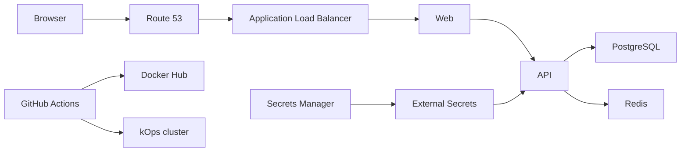

# AgriBridge

AgriBridge is a grain marketplace. Farmers publish produce, buyers place orders,
and both can follow an order through fulfilment. The web app is React and Vite.
The API is Express, with PostgreSQL and Redis.

Local development uses Docker Compose. The cloud environment is a kOps cluster
on AWS, with a short GitHub Actions pipeline that deploys QA and then production.

## Features

- **Farmer workspace:** publish crop lots with quantity, price and location.
- **Buyer workspace:** browse available produce and place orders.
- **Order management:** track status changes and order history.
- **Dashboard:** view marketplace activity and credit eligibility.
- **Role-based access:** separate farmer and buyer experiences with cookie-based authentication.

## Architecture



The web container serves the React app and proxies `/api` to Express. PostgreSQL
stores the data. Redis caches responses. The API exposes health, readiness,
metrics and version endpoints.

| Layer | Technology |
|---|---|
| Frontend | React, Vite, NGINX |
| API | Node.js, Express |
| Data | PostgreSQL and Redis in the cluster |
| Local environment | Docker Compose |
| Cluster | kOps on EC2. The manifest is `kops/cluster.yaml` |
| Delivery | GitHub Actions, Docker Hub, Helm |
| Traffic | Route 53, ACM, the AWS Load Balancer Controller installed by kOps |
| Secrets | AWS Secrets Manager and External Secrets, using the kOps service-account issuer |
| Observability | Prometheus, Grafana, Loki, Promtail and Tempo |

QA and production are namespaces on the same cluster. They use the same image
tag and separate secrets and database volumes. Build it in the order in
[docs/SETUP.md](docs/SETUP.md).

## Quick start

Install Docker with Docker Compose v2, then run:

```sh
git clone https://github.com/DeucesDevops/agribridge-project.git
cd agribridge-project
cp .env.example .env
docker compose up --build -d --wait
```

Open [http://localhost:8080](http://localhost:8080).

Compose builds the web app and the API, starts PostgreSQL and Redis, and loads
demonstration data. Copy `.env.example` to `.env` and change the passwords
before you start.

### Demo accounts

| Role | Email |
|---|---|
| Farmer | `amina.yusuf@example.ng` |
| Buyer | `procurement@sahelmills.example` |

The password is the value of `SEED_PASSWORD` in your local `.env`. QA can load
the same demonstration data. Production does not.

### Useful commands

```sh
docker compose ps
docker compose logs -f api
docker compose down
```

The web port defaults to `8080`. Set `WEB_LOCAL_PORT` in `.env` to change it.
Local PostgreSQL is published on `5433` unless `PG_LOCAL_PORT` is set.

## Development and testing

Use Node.js 22.

```sh
npm ci --prefix api
npm ci --prefix frontend
npm run test:coverage --prefix api
npm run test:coverage --prefix frontend
npm run build --prefix frontend
```

`make check` lints the Helm chart, checks Terraform formatting and runs the
SonarQube coverage helper tests. It needs Helm, Terraform and Python 3.

## Cloud delivery

GitHub Actions lints and tests the app, scans for secrets and vulnerabilities,
builds both images, writes a SBOM, and pushes them to Docker Hub. It then
installs the Helm chart in QA. Production waits for a reviewer on the
`production` environment and installs the same image tag.

kOps creates the cluster, including the AWS Load Balancer Controller and the
service-account issuer. Terraform creates the state bucket, the issuer bucket,
the certificate and the IAM roles. Images are published to Docker Hub. The
exact commands are in [docs/SETUP.md](docs/SETUP.md).

| Guide | Contents |
|---|---|
| [Setup](docs/SETUP.md) | Stage-by-stage build, from an empty AWS account to production |
| [Pipeline](docs/PIPELINE.md) | Each job, and the GitHub settings it needs |
| [Architecture](docs/ARCHITECTURE.md) | What runs where |
| [SonarQube](sonarqube/README.md) | Optional local code-quality server |

## Repository layout

| Directory | Purpose |
|---|---|
| `frontend/`, `api/` | Application source and tests |
| `.github/workflows/cicd.yaml` | The only delivery workflow |
| `kops/` | kOps cluster manifest |
| `terraform/` | Route 53 records, ACM, secrets and IAM |
| `helm/agribridge/` | Application chart |
| `platform/` | Storage class and observability Helm values |
| `sonarqube/` | Optional local SonarQube |
| `docs/` | Setup, pipeline and architecture |
