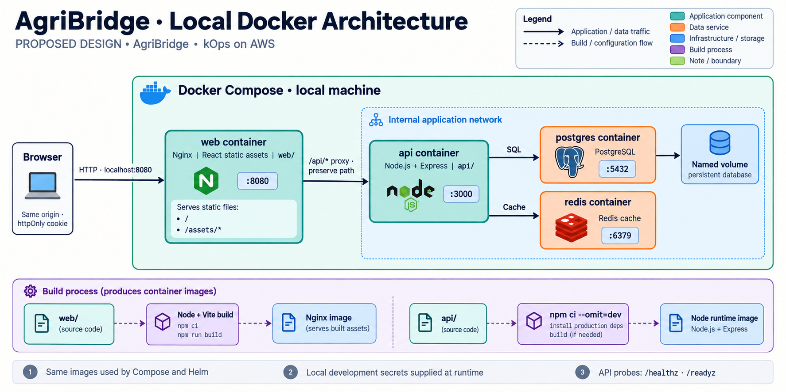
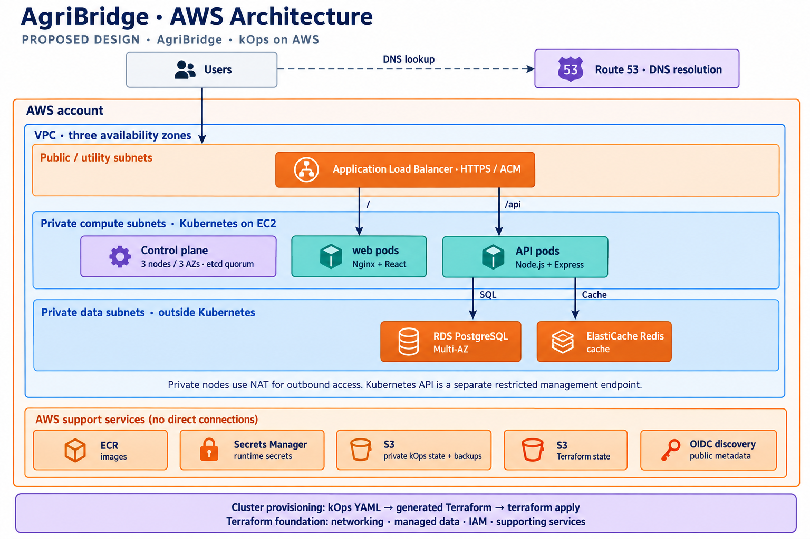
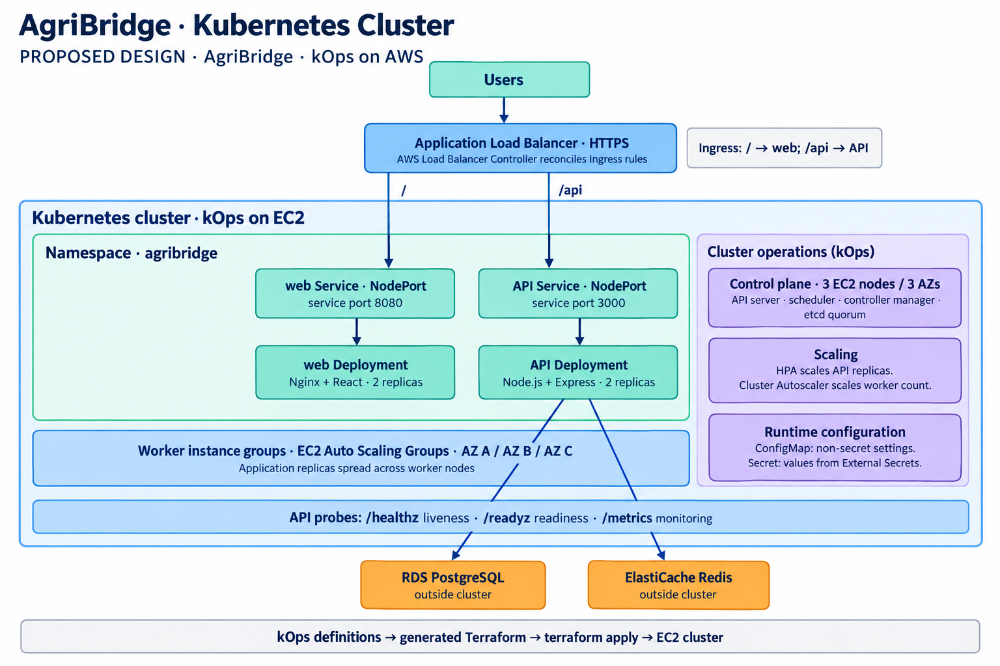
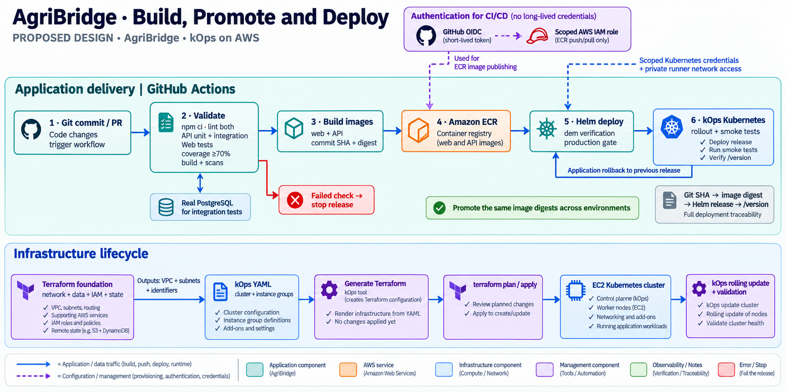
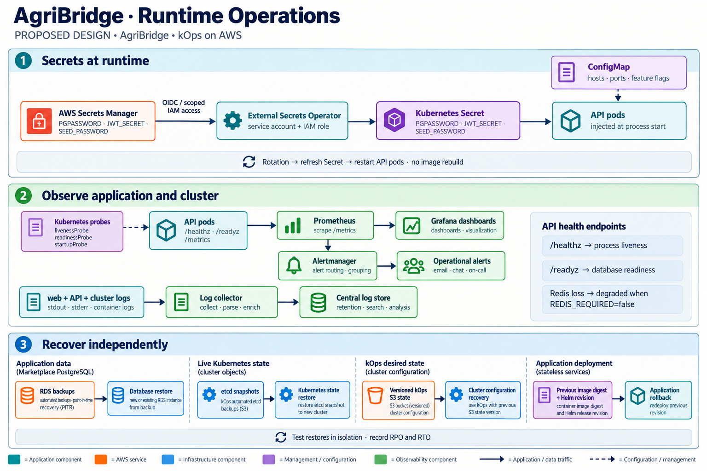

# AgriBridge architecture diagrams

[Repository structure](docs/repository-structure.md) · [Local development](docs/local-development.md)

These images illustrate the proposed kOps deployment and local Docker environment. They do not describe infrastructure that has already been deployed.

| Diagram | Scope |
| --- | --- |
| [Docker architecture](docs/architecture/01-docker-architecture.png) | Local Compose stack, same-origin Nginx routing, API dependencies, persistent PostgreSQL storage, and image builds. |
| [AWS architecture](docs/architecture/02-aws-architecture.png) | Three availability zones, public load balancing, private EC2 cluster nodes, managed data services, and supporting AWS services. |
| [Kubernetes cluster](docs/architecture/03-kubernetes-cluster.png) | Application Services and Deployments, separate control plane, instance groups, scaling, and runtime configuration. |
| [Delivery pipeline](docs/architecture/04-delivery-pipeline.png) | Required application checks, image publishing and promotion, Helm deployment, and Terraform/kOps infrastructure lifecycle. |
| [Runtime operations](docs/architecture/05-runtime-operations.png) | Secret delivery, health checks, metrics, logs, alerts, and independent recovery procedures. |

## Design assumptions

- The existing components remain named `web/` and `api/`.
- The proposed Nginx image listens on port 8080. The API's existing default port is 3000; PostgreSQL and Redis use 5432 and 6379.
- Local Compose publishes only the web port. Nginx forwards `/api` to the API without stripping that prefix.
- In AWS, the ALB routes `/` to web and `/api` directly to the API using Ingress rules reconciled by the AWS Load Balancer Controller. The proposed diagram uses instance targets and NodePort Services. Ingress is routing configuration, not a separate proxy process.
- The production cluster has three control-plane nodes across three availability zones and worker instance groups in private subnets. RDS and ElastiCache are external managed data services.
- The Kubernetes API endpoint is separate from the public application endpoint. CI deployment requires both authorized Kubernetes credentials and network access to this endpoint.
- kOps defines the cluster and generates Terraform configuration; Terraform provisions the cluster infrastructure. This adjusts the earlier direct-kOps provisioning proposal to meet the repository's Terraform requirement. kOps remains the source of truth for generated cluster configuration; changes may require a rolling update after Terraform apply.
- Terraform state, private kOps state, public OIDC discovery metadata, etcd backups, and PostgreSQL backups have distinct purposes and access controls.
- Runtime API secrets come from Secrets Manager via External Secrets Operator. Secret rotation includes restarting affected processes after the Kubernetes Secret refreshes.
- `/healthz` checks process liveness. `/readyz` checks database availability and reports Redis degradation when the cache is enabled and `REDIS_REQUIRED=false`. Operational endpoints retain their root paths and are accessed internally for probes and metrics.
- Redis caches price-index and dashboard data. It does not store authentication sessions; authentication uses signed JWTs carried by cookies.
- A real PostgreSQL instance supports CI integration tests. The existing API domain coverage gate is 70%; images are promoted unchanged across environments.
- Application rollback does not automatically reverse database schema changes. Migration compatibility and database restoration need separate procedures.

## Sources and generation

The component names, routes, ports, runtime behavior, and required checks were checked against the repository README and API source. Cloud topology and operational paths are proposed design choices.

- [kOps Terraform integration](https://kops.sigs.k8s.io/terraform/)
- [kOps in an existing VPC](https://kops.sigs.k8s.io/run_in_existing_vpc/)
- [kOps AWS setup and state stores](https://kops.sigs.k8s.io/getting_started/aws/)
- [kOps addons](https://kops.sigs.k8s.io/addons/)
- [kOps etcd recovery](https://kops.sigs.k8s.io/operations/etcd_backup_restore_encryption/)

Images were created using the built-in image generation tool. The full [prompt set](docs/architecture/image-prompts.md) is saved alongside them for reproducibility and future edits.
