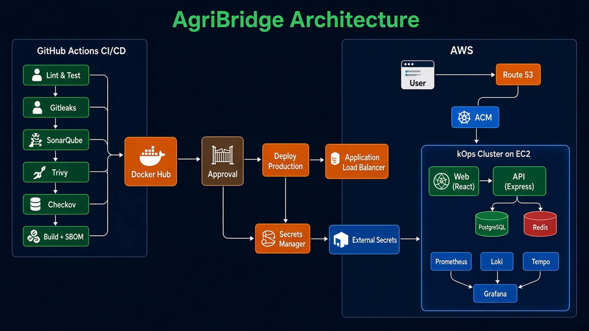

# AgriBridge

AgriBridge is a grain marketplace. Farmers publish produce, buyers place orders,
and both can follow an order through fulfilment. The web app is React and Vite.
The API is Express, with PostgreSQL and Redis.

Local development uses Docker Compose. The cloud environment is a kOps cluster
on AWS, with a short GitHub Actions pipeline that deploys QA and then production.

## Features

- **Farmer workspace:** publish crop lots with quantity, price and location.
- **Buyer workspace:** browse available produce and place orders.
- **Order management:** track status changes and order history.
- **Dashboard:** view marketplace activity and credit eligibility.
- **Role-based access:** separate farmer and buyer experiences with cookie-based authentication.

## Architecture



The diagram is the delivery path. kOps renders the cluster into Terraform, and Terraform creates it.

A request reaches the API like this. A browser opens the QA or production
hostname. Route 53 sends it to one Application Load Balancer. TLS is the ACM
certificate. The load balancer sends traffic to the web pod, which serves the
React app and proxies `/api` to Express in the same namespace. Express stores
data in PostgreSQL and caches in Redis. If Redis is down, the API keeps reading
PostgreSQL and says so on `/readyz`.

Locally, Docker Compose runs the same four processes on your machine. In AWS
they run from one Helm chart, `helm/agribridge`, with `values-qa.yaml` and
`values-production.yaml`. The namespaces are `agribridge-qa` and
`agribridge-production`. They share an image tag and keep separate database
volumes and secrets.

The picture is the delivery path. The workflow file is [`.github/workflows/cicd.yaml`](.github/workflows/cicd.yaml).
SonarQube runs on `main` only when `SONAR_TOKEN` and `SONAR_HOST_URL` are set.
On `main`, the images are pushed to `docker.io/macroni607/agribridge-api` and
`docker.io/macroni607/agribridge-web`. QA installs immediately. Production
waits for the `production` GitHub environment, then installs the same tag.
Pull requests and pushes to `dev` stop after the scans. They do not push or deploy.

kOps renders the cluster from [`kops/cluster.yaml`](kops/cluster.yaml) into
Terraform, and `terraform apply` creates it: the VPC, the EC2 nodes, the EBS
CSI driver, the AWS Load Balancer Controller, and the service-account issuer.
The same root creates the public DNS zone, the certificate, the Secrets
Manager secrets, the backup bucket and the IRSA roles for External Secrets,
ExternalDNS and the database backup. A second apply installs External Secrets,
ExternalDNS and the monitoring charts. External Secrets copies `PGPASSWORD`,
`JWT_SECRET`, and `SEED_PASSWORD` into each namespace. The role trust uses the
kOps issuer and the audience `amazonaws.com`. Production runs a daily
`pg_dump` to S3. Grafana is at `https://grafana.<zone>` and asks for the admin
password.

Prometheus scrapes the API. Promtail ships container logs to Loki. Grafana
reads Prometheus, Loki, and Tempo. The API does not emit traces yet, so Tempo
is installed and empty.

| Layer | Where it lives |
|---|---|
| Frontend | React and Vite, served by NGINX |
| API | Express on Node.js |
| Data | PostgreSQL and Redis, one volume per namespace |
| Local | Docker Compose |
| Chart | `helm/agribridge` with QA and production values |
| Cluster | kOps, rendered to Terraform in `terraform/kops` |
| AWS around the cluster | `terraform/`: zone, certificate, secrets, backup bucket, IRSA, platform charts |
| Images | Docker Hub `macroni607/agribridge-api` and `macroni607/agribridge-web` |
| Traffic | Route 53 and ACM to the ALB, then the web Service |
| Secrets | Secrets Manager through External Secrets |
| Observability | Prometheus, Grafana, Loki, Promtail, Tempo |

The repository does not include Argo CD, an NGINX ingress or a Network Load
Balancer, Fluent Bit or CloudWatch logs, composite actions, or separate
Terraform roots. The environment name is QA, not staging. Build the cloud
environment in the order in [docs/SETUP.md](docs/SETUP.md). The longer
explanation is [docs/ARCHITECTURE.md](docs/ARCHITECTURE.md).

## Quick start

Install Docker with Docker Compose v2, then run:

```sh
git clone https://github.com/DeucesDevops/agribridge-project.git
cd agribridge-project
cp .env.example .env
docker compose up --build -d --wait
```

Open [http://localhost:8080](http://localhost:8080).

Compose builds the web app and the API, starts PostgreSQL and Redis, and loads
demonstration data. Copy `.env.example` to `.env` and change the passwords
before you start.

### Demo accounts

| Role | Email |
|---|---|
| Farmer | `amina.yusuf@example.ng` |
| Buyer | `procurement@sahelmills.example` |

The password is the value of `SEED_PASSWORD` in your local `.env`. QA can load
the same demonstration data. Production does not.

### Useful commands

```sh
docker compose ps
docker compose logs -f api
docker compose down
```

The web port defaults to `8080`. Set `WEB_LOCAL_PORT` in `.env` to change it.
Local PostgreSQL is published on `5433` unless `PG_LOCAL_PORT` is set.

## Development and testing

Use Node.js 22.

```sh
npm ci --prefix api
npm ci --prefix frontend
npm run test:coverage --prefix api
npm run test:coverage --prefix frontend
npm run build --prefix frontend
```

`make check` lints the Helm chart, checks Terraform formatting and runs the
SonarQube coverage helper tests. It needs Helm, Terraform and Python 3.

## Cloud delivery

GitHub Actions lints and tests the app, scans for secrets and vulnerabilities,
builds both images, writes a SBOM, and pushes them to Docker Hub. It then
installs the Helm chart in QA. Production waits for a reviewer on the
`production` environment and installs the same image tag.

kOps renders the cluster and Terraform creates it, the zone, the certificate,
the IAM roles and the platform charts. `scripts/bootstrap-state.sh` creates
the Terraform state bucket, which Terraform needs before it can start. The
kOps state bucket is separate and is managed by Terraform. Images are
published to Docker Hub. The exact commands are in [docs/SETUP.md](docs/SETUP.md).

| Guide | Contents |
|---|---|
| [Setup](docs/SETUP.md) | Stage-by-stage build, from an empty AWS account to production |
| [Pipeline](docs/PIPELINE.md) | Each job, and the GitHub settings it needs |
| [Architecture](docs/ARCHITECTURE.md) | What runs where |
| [SonarQube](sonarqube/README.md) | Optional local code-quality server |

## Repository layout

| Directory | Purpose |
|---|---|
| `frontend/`, `api/` | Application source and tests |
| `.github/workflows/cicd.yaml` | The only delivery workflow |
| `kops/` | kOps cluster spec |
| `terraform/` | Rendered kOps cluster, DNS, secrets, backup bucket, IAM, platform charts |
| `helm/agribridge/` | Application chart, including the production backup |
| `platform/` | Storage class and observability Helm values |
| `scripts/` | State bucket, apply, restore and teardown |
| `sonarqube/` | Optional local SonarQube |
| `docs/` | Setup, pipeline and architecture |
