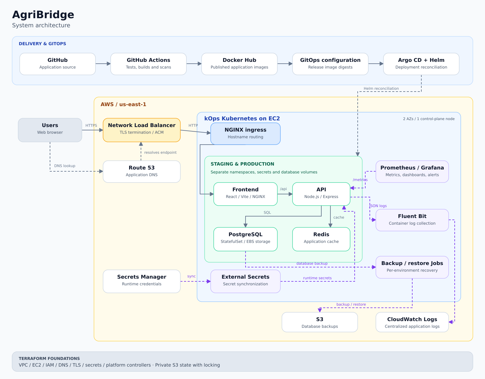

# AgriBridge

AgriBridge is a grain marketplace connecting farmers with institutional buyers.
Farmers publish available produce, buyers place orders, and both can track orders
through fulfilment. A mobile-first React interface is backed by an Express API,
PostgreSQL and Redis.

The repository includes a complete local environment and an automated AWS
Kubernetes deployment with separate staging and production environments.

## Features

- **Farmer workspace:** publish crop lots with quantity, price and location.
- **Buyer workspace:** browse available produce and place orders.
- **Order management:** track status changes and order history.
- **Dashboard:** view marketplace activity and credit eligibility.
- **Role-based access:** separate farmer and buyer experiences with cookie-based authentication.

## Architecture



The frontend serves the web application and proxies `/api` requests to Express
through the same origin. PostgreSQL stores application data; Redis caches
responses. The API exposes health, readiness, metrics and build-version endpoints.

| Layer | Technology |
|---|---|
| Frontend | React, Vite, NGINX |
| API | Node.js, Express |
| Data | PostgreSQL with persistent storage; Redis |
| Local environment | Docker Compose |
| Infrastructure | Terraform; kOps Kubernetes on AWS EC2 |
| Delivery | GitHub Actions, Docker Hub, Helm, Argo CD |
| Traffic and secrets | Route 53, ACM, Network Load Balancer, NGINX ingress, AWS Secrets Manager, External Secrets Operator |
| Observability and recovery | Prometheus, Grafana, Fluent Bit, CloudWatch Logs, S3 database backups |

Staging and production share a cluster, with separate namespaces, secrets and
database volumes. Both run the same application image digests. See the
[architecture reference](docs/ARCHITECTURE.md) for deployment details.

## Quick start

Install Docker with **Docker Compose v2**, then run:

```sh
git clone https://github.com/DeucesDevops/agribridge-project.git
cd agribridge-project
cp .env.example .env
docker compose up --build -d --wait
```

Open **[http://localhost:8080](http://localhost:8080)**.

Compose builds the frontend and API, starts PostgreSQL and Redis, and initializes
the database with demonstration data. The example environment contains local
values; choose your own throwaway values in `.env` before starting.

### Demo accounts

| Role | Email |
|---|---|
| Farmer | `amina.yusuf@example.ng` |
| Buyer | `procurement@sahelmills.example` |

Use the value of **`SEED_PASSWORD` in your local `.env`** as the password for both
accounts. Demo data is enabled locally; production is not seeded.

### Useful commands

```sh
# Check the containers
docker compose ps

# Follow API logs
docker compose logs -f api

# Stop the application; retain database data
docker compose down
```

The web port defaults to `8080`. To use another port, add `WEB_LOCAL_PORT=8081`
to `.env` and restart Compose. Local PostgreSQL is available on port `5433`;
`PG_LOCAL_PORT` overrides it.

## Development and testing

Use **Node.js 22** for application development. Install dependencies and run the
application tests and frontend build:

```sh
npm ci --prefix api
npm ci --prefix frontend
npm run test:coverage --prefix api
npm run test:coverage --prefix frontend
npm run build --prefix frontend
```

With Docker and Make installed, `make local-verify` exercises a disposable
container stack, including PostgreSQL integration tests, Redis degradation and
database persistence. `make check` validates helper code, Helm and Terraform
formatting; it also requires Python dependencies from `scripts/requirements.txt`,
Helm and Terraform.

## Deployment

GitHub Actions validates changes, builds and scans container images, and publishes
them to Docker Hub. Release image digests are recorded in GitOps configuration;
Argo CD reconciles the application Helm chart. Production promotion reuses the
images verified in staging.

Terraform provisions AWS infrastructure and platform services. Runtime credentials
come from AWS Secrets Manager through External Secrets Operator. Monitoring,
centralized logs and database backup/restore jobs support application operations.

| Guide | Contents |
|---|---|
| [Configuration](docs/CONFIGURATION.md) | Environment settings, repository variables and secrets |
| [Deployment guide](docs/REPRODUCTION.md) | Infrastructure setup and deployment prerequisites |
| [Operations runbook](docs/OPERATIONS.md) | Monitoring, rollback, backup, restore and teardown |
| [SonarQube](sonarqube/README.md) | Optional local code-quality analysis |

## Repository layout

| Directory | Purpose |
|---|---|
| `frontend/`, `api/` | Application source and tests |
| `.github/workflows/` | Delivery, infrastructure and operations workflows |
| `terraform/` | Infrastructure configuration and reusable modules |
| `kubedefs/` | kOps cluster and ingress definitions |
| `helm/` | Application and Argo CD bootstrap charts |
| `argocd/` | GitOps applications and release values |
| `monitoring/`, `sonarqube/` | Observability and code-quality configuration |
| `scripts/` | Local verification and workflow helpers |
| `docs/` | Architecture, configuration and operations documentation |
