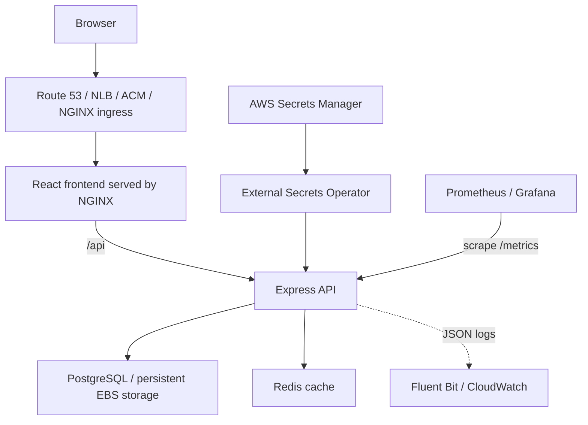

# AgriBridge — DevOps Capstone

A reproducible delivery platform for a grain marketplace connecting farmers and
institutional buyers. This capstone packages the supplied React and Express
application into containers and delivers it to Kubernetes on AWS using
**Terraform, Helm, Docker Compose and GitHub Actions**.

The implementation covers local development, automated testing, immutable image
releases, runtime secrets, persistent PostgreSQL storage, monitoring, rollback
and backup recovery. Staging and production use the same application image digests
with separate runtime configuration and data.

## Architecture



The frontend serves the application and proxies API requests through one origin,
which preserves cookie-based authentication. Redis improves response time; its
loss produces an observable degraded state while PostgreSQL continues serving
requests. Database loss makes the API unready.

| Layer | Implementation |
|---|---|
| Application | React/Vite frontend; Node.js/Express API; PostgreSQL; Redis |
| Containers and local environment | Multi-stage, non-root Docker images; Docker Compose |
| Infrastructure | Terraform modules; kOps-managed Kubernetes on EC2; S3 state with locking |
| Application deployment | One Helm chart; Argo CD reconciliation; separate staging/production namespaces |
| Traffic and secrets | Route 53, ACM, AWS NLB, NGINX; Secrets Manager and External Secrets |
| Operations | Prometheus/Grafana metrics; Fluent Bit/CloudWatch logs; scheduled S3 backups |

## Assessment requirements

The [original specification](docs/ASSESSMENT.md) defines four mandatory tools and
the operational behavior they must deliver together.

| Requirement | Implementation |
|---|---|
| Reproducible infrastructure, state management and no SSH setup | [Terraform](terraform/), remote state, account guards and infrastructure outputs |
| Both application components deployed with one chart across environments | [Application Helm chart](helm/agribridge/) with staging and production values |
| Complete local stack using the same application Dockerfiles/images | [Docker Compose](docker-compose.yml): frontend, API, PostgreSQL and Redis |
| Automated checks, publication and deployment; failed checks block release | [GitHub Actions delivery workflow](.github/workflows/delivery.yaml) |
| Persistent PostgreSQL, Redis availability and runtime secret delivery | StatefulSet/PVC storage, Redis, Secrets Manager and External Secrets |
| Build identity separated from runtime configuration | Commit/version metadata in images and `/version`; environment values supplied at runtime |
| Liveness, readiness and graceful termination | `/healthz`, `/readyz`, startup probes and termination grace configuration |
| Metrics, logs and observable cache degradation | Prometheus/Grafana, CloudWatch and recorded resilience checks |
| Rollback, backup and demonstrated database recovery | Git-based digest rollback, backup CronJobs and isolated restore verification |
| Reproducible configuration and documented operation | [Configuration](docs/CONFIGURATION.md), [deployment guide](docs/REPRODUCTION.md) and [operations runbook](docs/OPERATIONS.md) |

The API coverage gate enforces **70%** for lines, functions, branches and
statements in the domain layer. The pipeline runs API unit tests, integration
tests against real PostgreSQL, frontend tests, dependency audits and production
build checks. It publishes JUnit/coverage artifacts, rejects lint warnings and
enforces a **250 KiB per-chunk** frontend JavaScript budget.

## Delivery and environment promotion

1. Pull requests run application, Helm, workflow and Terraform validation checks.
2. A release from `main` builds both images with commit-derived identity and
   exercises those exact images in Compose before scanning and publication.
3. The published Docker Hub image digests are committed to staging's GitOps values.
4. Argo CD renders the Helm chart and reconciles staging. Public HTTPS, readiness
   and running-version checks verify the requested release.
5. Production receives the same verified image digests without rebuilding.
   A failed prerequisite prevents the dependent release jobs from running.

Terraform provisions the infrastructure and installs platform controllers.
Argo CD owns application deployment. Environment differences are expressed as
values rather than duplicated charts or rebuilt frontend bundles.

Secret values are delivered at runtime and excluded from Git, image layers and
build arguments. Terraform state and saved plans use private storage because they
can contain sensitive material. Production is unseeded; local development and
staging provide demonstration data.

## Run locally

Docker with Compose v2 and Make are required to start the application:

```sh
git clone https://github.com/DeucesDevops/agribridge-project.git
cd agribridge-project
cp .env.example .env
make local
```

Open **http://localhost:8080**. The example environment file contains local-only
values. `make stop` stops the stack and retains its database volume.

For source and infrastructure checks, install Node.js 22, Python, Terraform and
Helm, then follow the dependency setup in the
[reproduction guide](docs/REPRODUCTION.md).

| Command | Purpose |
|---|---|
| `make check` | Helper/coverage tests, Bash syntax, Terraform formatting and Helm lint |
| `make local-verify` | Disposable local stack, PostgreSQL integration tests, cache resilience and persistence checks |
| `make render ENV=staging` | Inspect the selected environment's rendered Kubernetes resources |
| `make help` | List the available local commands |

Cloud configuration and the infrastructure stage order are documented in
[REPRODUCTION.md](docs/REPRODUCTION.md). Application delivery runs through
GitHub Actions and Argo CD; infrastructure and maintenance have separate manual
workflow entry points.

## Repository structure

```text
agribridge-project/
├── api/                         # API source, migrations, tests and Dockerfile
├── frontend/                    # Frontend source, tests, NGINX and Dockerfile
├── .github/
│   ├── workflows/               # Delivery, infrastructure and operations
│   └── actions/cloud-tools/     # Shared tools and short-lived AWS authentication
├── terraform/
│   ├── main.tf                  # Application AWS services
│   ├── providers.tf
│   ├── variables.tf
│   ├── outputs.tf
│   ├── bootstrap/               # Persistent foundations and state storage
│   ├── cluster/                 # Cluster Terraform entry point
│   ├── platform/                # Controllers, ingress, storage and monitoring
│   └── modules/                 # Reusable resource definitions
├── kubedefs/                    # Authored cluster and ingress configuration
├── helm/
│   ├── agribridge/              # One application chart and environment values
│   └── argocd-bootstrap/        # Platform installation of GitOps definitions
├── argocd/                      # Applications and runtime/release selections
├── monitoring/                  # Metrics and logging configuration
├── sonarqube/                   # Optional code-quality integration
├── scripts/                     # Five focused helpers and their tests
├── docs/                        # Specification, runbooks and assessment evidence
├── docker-compose.yml
└── Makefile
```

Generated cluster Terraform, state, plans, kubeconfigs, dependency directories
and local runtime files are excluded from Git. Application manifests are authored
in Helm; `kubedefs/` does not maintain a competing copy of them.

## Validation and operational evidence

| Demonstration | Evidence |
|---|---|
| Automated application and platform-source checks | [Successful CI run — 7 November 2026](https://github.com/DeucesDevops/agribridge-project/actions/runs/42424238771) |
| Image publication and staging/production delivery | [Successful release — 2 November 2026](https://github.com/DeucesDevops/agribridge-project/actions/runs/41473944213) |
| Git-based rollback and restoration of the deployed release | [Rollback demonstration](docs/evidence/ROLLBACK-REVIEW.md) |
| Cache degradation, persistent data and backup restoration | [Operational acceptance results](docs/evidence/ACCEPTANCE.md) |
| Metrics, logs and internal alert delivery | [Monitoring demonstration](docs/evidence/STAGE7-REVIEW.md) |

The AWS demonstration environments were decommissioned after validation to control
costs. The recorded live demonstrations predate the workflow refactor; the
refactored infrastructure and maintenance workflows have not been executed
against AWS. CI validation and historical deployment evidence are distinguished
in the [verification record](docs/VERIFICATION.md).

The capstone uses one control-plane node and a shared cluster with separate
environment namespaces. This is a cost-conscious demonstration topology rather
than a highly available production deployment.

## Extensions beyond the brief

The assessed toolchain is Terraform, Helm, Docker Compose and GitHub Actions.
This implementation also includes Argo CD for GitOps, Trivy image scanning,
optional SonarQube analysis, and separate infrastructure/operations workflows.
These support the chosen implementation; they are not additional course
requirements. The SonarQube integration remains optional and no passing
server-side analysis is claimed by its configuration alone.

## Documentation

- [Original assessment specification](docs/ASSESSMENT.md)
- [Architecture and design decisions](docs/ARCHITECTURE.md)
- [Configuration](docs/CONFIGURATION.md) and [deployment guide](docs/REPRODUCTION.md)
- [Operations, rollback and recovery](docs/OPERATIONS.md)
- [Verification record](docs/VERIFICATION.md)
