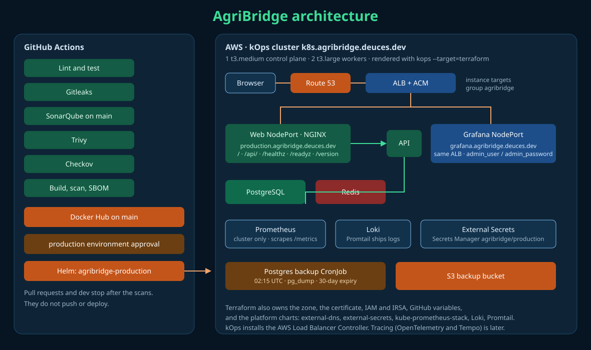

# Architecture



The diagram is the delivery path. The cluster is kOps, and Terraform creates the machines from the rendered spec.

## Application

The web app is React and Vite, served by NGINX. PostgreSQL stores marketplace
data. Redis caches responses. If Redis is unreachable, the API reads PostgreSQL
and reports the degradation on `/readyz`.

The API mounts `/healthz`, `/readyz`, `/version`, and `/metrics` at the root.
Application routes are under `/api` (`/api/auth`, `/api/lots`, `/api/orders`,
`/api/stats`). Auth is login, logout, and the current session. New users are
created by the demo seed, not by a registration endpoint.

NGINX is what the load balancer calls. `frontend/nginx.conf.template` routes
the public hostname as follows.

| Public path | Who answers |
|---|---|
| `/` and `/assets/` | The built React app |
| `/api/` | Proxied to the API Service. The prefix is unchanged |
| `/healthz` | NGINX returns `ok`. The ALB health check uses this path |
| `/readyz` | Proxied to the API `/readyz` |
| `/version` | Proxied to the API `/version` |
| `/metrics` | Not listed. The SPA fallback answers the public URL |

Prometheus uses a ServiceMonitor on the API Service, port `http`, path
`/metrics`. The API probes use `/healthz` (liveness and startup) and `/readyz`
(readiness). Those probes talk to the API container, not to NGINX.

Docker Compose runs the same four processes for local development and sets
`SEED_DEMO_DATA=true`. The same processes run in Kubernetes from one chart,
`helm/agribridge`.

| File | Namespace | Host | Demo data |
|---|---|---|---|
| `values-production.yaml` | `agribridge-production` | `production.agribridge.deuces.dev` | Loaded once, with `SEED_DEMO_DATA=false` |

The release uses the image tag committed in `values-production.yaml` on `main`.
The namespace has its own database volume and the Secrets Manager secret
`agribridge/production`.

## Pipeline

The file is [`.github/workflows/cicd.yaml`](../.github/workflows/cicd.yaml).
SonarQube runs on `main` when `SONAR_TOKEN` and `SONAR_HOST_URL` are set, and
the job succeeds with a skip message otherwise. A push to `main` publishes
`docker.io/macroni607/agribridge-api` and
`docker.io/macroni607/agribridge-web`. The `production` GitHub environment
must approve that tag before the workflow commits it to
`values-production.yaml`. The commit author is DeucesDevops and the message
contains `[skip ci]`, so the bump does not build again. Argo CD tracks `main`
and syncs `helm/agribridge` with prune and selfHeal.
Pull requests and `dev` finish after the image scan and SBOM.

## Cluster and AWS

The cluster spec is [`kops/cluster.yaml`](../kops/cluster.yaml). kOps 1.36.2
renders it with `kops update cluster --target=terraform` into
[`terraform/modules/cluster`](../terraform/modules/cluster) and [`terraform/modules/network`](../terraform/modules/network), and Terraform creates what those files
describe: the VPC, one `t3.medium` control plane, two `t3.large` workers,
encrypted root disks, no SSH key, the API on port 443, Calico, the EBS CSI
driver, the AWS Load Balancer Controller and the service-account issuer.
The issuer is `https://agribridge-oidc-237258628535.s3.us-east-1.amazonaws.com`
and the token audience is `amazonaws.com`.

Rendering also writes the cluster certificates into `s3://kops-state-607`.
The node configuration Terraform uploads has to match those certificates, so
`scripts/render-kops-terraform.sh` is run before apply. The GitHub Actions role
can still read the state bucket and export a kubeconfig with
`kops export kubeconfig --admin`. The pipeline does not use that credential.
The image-tag job only pushes a commit.

The same root also creates:

- the public Route 53 zone `agribridge.deuces.dev` and the ACM certificate for that name and `*.agribridge.deuces.dev`
- the GitHub Actions OIDC role, and it writes that role ARN to GitHub
- Secrets Manager secrets `agribridge/production` and `agribridge/grafana`
- IRSA roles for External Secrets, ExternalDNS and the database backup. The load balancer controller and the EBS driver roles are in the kOps output
- the kOps state bucket, the OIDC discovery bucket and the backup bucket
- the platform Helm releases, on a second apply with `install_platform=true`: Argo CD, external-secrets, external-dns, kube-prometheus-stack, Loki, and Promtail

`scripts/bootstrap-state.sh` creates the Terraform state bucket. Terraform
needs that bucket before the first `init`, so it cannot create it. A rebuild
starts with that script, then `terraform/environments/production`.

```
terraform/
├── bootstrap/            # state bucket, local state, first
├── modules/
│   ├── network/          # VPC, public subnets, routes, no NAT
│   ├── cluster/          # control plane, nodes, IAM, security groups
│   ├── dns/              # zone and certificate
│   ├── storage/          # buckets, KMS, Secrets Manager
│   ├── identity/         # GitHub OIDC, CI role, IRSA
│   └── platform/         # Helm releases on the second apply
└── environments/
    ├── production/       # root scripts/apply-environment.sh applies
    └── dev/              # separate state key
```

## Traffic and secrets

The Route 53 name `production.agribridge.deuces.dev` points at the ALB. The
Ingress in the Helm chart joins the load balancer group `agribridge`, sets
`target-type` to `instance`, and attaches the ACM certificate. The web Service
is a NodePort because Calico pod IPs are not routable from the VPC.
ExternalDNS creates the records from the Ingress host. Grafana uses a second
Ingress in that same group, also with instance targets, and its Service is a
NodePort. The hostname is `grafana.agribridge.deuces.dev`. Grafana's own
health check path is `/api/health`, which is Grafana's API, not the AgriBridge
API. Argo CD uses a third Ingress in that group. The Service is a NodePort,
the target type is `instance`, and the hostname is `argocd.agribridge.deuces.dev`.
The load balancer terminates TLS and talks HTTP to the server. The health check
path is `/healthz`.

External Secrets reads Secrets Manager with an IAM role. The trust policy uses
the kOps issuer and the audience `amazonaws.com`. The synced secret supplies
`PGPASSWORD`, `JWT_SECRET`, and `SEED_PASSWORD`.

Production PostgreSQL is backed up by a CronJob in the application chart. It
runs `pg_dump` and uploads the file to S3 with its own IRSA role. Restore is
`scripts/restore-postgres.sh`.

## Observability

Prometheus scrapes `/metrics` through a ServiceMonitor. Promtail ships
container logs to Loki. Grafana's datasources are Prometheus and Loki.
Grafana is served at [https://grafana.agribridge.deuces.dev](https://grafana.agribridge.deuces.dev)
on the same load balancer. Anonymous access and sign-up are off. The username
and password are the `admin_user` and `admin_password` keys in Secrets Manager
`agribridge/grafana`.

Argo CD is served at [https://argocd.agribridge.deuces.dev](https://argocd.agribridge.deuces.dev).
The username is `admin`. The generated password is in
`argocd-initial-admin-secret`. Read it with:

```sh
kubectl -n argocd get secret argocd-initial-admin-secret -o jsonpath='{.data.password}' | base64 -d && echo
```

The Application `agribridge` lives in the `argocd` namespace. It points at
`https://github.com/DeucesDevops/agribridge-project.git`, revision `main`,
path `helm/agribridge`, and value files `values.yaml` and
`values-production.yaml`. The repository is public, so Argo CD clones it
without a credential. Automated sync is on, with prune and selfHeal.
Terraform sets the Helm parameters `hostname`, `region`, `certificateArn`,
`backup.bucket` and `backup.roleArn` on that Application. Image tags are not
parameters. They come from the committed values file, which is why the
approved CI commit is what production runs. Argo CD reconciles git about
every 60 seconds. Refresh sooner with:

```sh
kubectl -n argocd annotate application agribridge argocd.argoproj.io/refresh=hard --overwrite
```

Prometheus has no Ingress. Query it from Grafana Explore, or from a machine
that has a kubeconfig:

```sh
kubectl -n monitoring port-forward svc/monitoring-kube-prometheus-prometheus 9090
```

The UI is then at `http://127.0.0.1:9090`.

Distributed tracing is a later addition. That work is OpenTelemetry in the API
plus Tempo as the store. The platform module does not install Tempo, and the
API does not export spans.

## What this repository does not contain

An NGINX ingress controller, a Network Load Balancer, Fluent Bit,
CloudWatch Logs, and composite GitHub Actions are not part of this design.
Terraform roots are `environments/production`, `environments/dev`, and
`bootstrap`. `scripts/apply-environment.sh` applies production. Argo CD Image
Updater is not installed. The pipeline commits the tag itself, after the
production approval.
