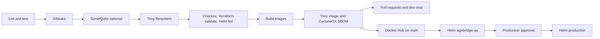

# Architecture


The diagram is rendered from [`diagrams/architecture.mmd`](diagrams/architecture.mmd).
Regenerate it with Mermaid CLI:

```sh
npx @mermaid-js/mermaid-cli -i docs/diagrams/architecture.mmd \
  -o docs/images/agribridge-architecture.svg \
  -c docs/diagrams/mermaid-config.json -b white
```

## Application

The web app is React and Vite, served by NGINX. It proxies `/api` to the
Express API. PostgreSQL stores marketplace data. Redis caches responses. If
Redis is unreachable, the API reads PostgreSQL and reports the degradation on
`/readyz`. The API also exposes `/healthz`, `/metrics`, and `/version`.

Docker Compose runs those four processes for local development. The same
processes run in Kubernetes from one chart, `helm/agribridge`.

| File | Namespace | Host | Demo data |
|---|---|---|---|
| `values-qa.yaml` | `agribridge-qa` | `qa.<zone>` | Loaded on startup |
| `values-production.yaml` | `agribridge-production` | `production.<zone>` | Not loaded |

Both releases use one image tag. Each namespace has its own database volume
and its own Secrets Manager secret.

## Pipeline



The file is [`.github/workflows/cicd.yaml`](../.github/workflows/cicd.yaml).
SonarQube runs on `main` when `SONAR_TOKEN` and `SONAR_HOST_URL` are set, and
the job succeeds with a skip message otherwise. A push to `main` publishes
`docker.io/macroni607/agribridge-api` and
`docker.io/macroni607/agribridge-web`, then runs `helm upgrade` in
`agribridge-qa`. The `production` GitHub environment must approve the same tag
before the production install. Pull requests and `dev` finish after the image
scan and SBOM.

## Cluster and AWS

kOps creates the cluster from [`kops/cluster.yaml`](../kops/cluster.yaml):

- VPC and EC2 nodes
- EBS CSI driver
- cert-manager
- AWS Load Balancer Controller
- service-account OIDC issuer, published to the discovery bucket

The Terraform root in `terraform/` does not create the cluster. It creates:

- the GitHub Actions OIDC role, used to read the kOps state store and deploy
- the ACM certificate for the zone and `*.zone`
- Secrets Manager secrets `agribridge/qa` and `agribridge/production`
- IRSA roles for External Secrets and ExternalDNS, after kOps has registered the issuer

## Traffic and secrets

Route 53 names `qa.<zone>` and `production.<zone>` point at one ALB. The
Ingress in the Helm chart asks the load balancer controller for that ALB and
attaches the ACM certificate. ExternalDNS creates the records from the Ingress
host.

External Secrets reads Secrets Manager with an IAM role. The trust policy uses
the kOps issuer and the audience `amazonaws.com`. The synced secret supplies
`PGPASSWORD`, `JWT_SECRET`, and `SEED_PASSWORD`.

## Observability

Prometheus scrapes `/metrics` through a ServiceMonitor. Promtail ships
container logs to Loki. Grafana is configured with Prometheus, Loki, and Tempo
datasources. The API does not export traces, so Tempo has no application spans
until a tracer is added. Grafana stays inside the cluster and is opened with
`kubectl port-forward`.

## What this repository does not contain

Argo CD, an NGINX ingress controller, a Network Load Balancer, Fluent Bit,
CloudWatch Logs, application backup jobs, composite GitHub Actions, custom
verification scripts, and extra Terraform roots are not part of this design.
The environment name is QA.
