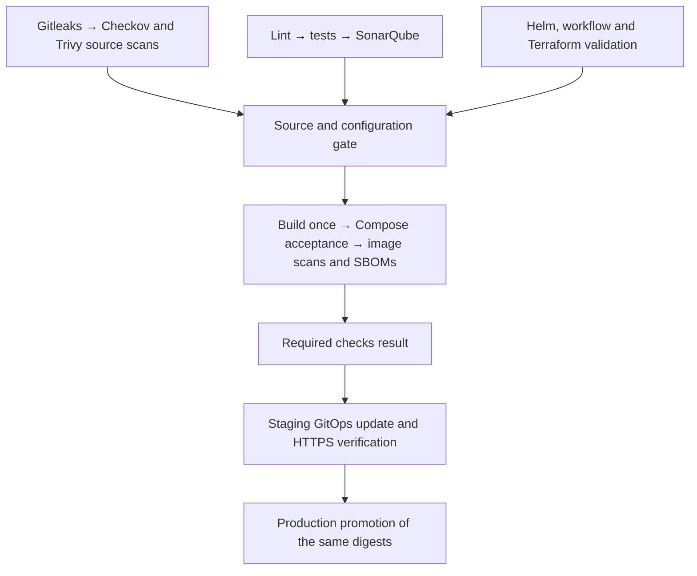

# AgriBridge DevSecOps pipeline

The delivery workflow now uses separate, named jobs like the supplied framework.
It keeps AgriBridge's two applications and GitOps deployment contract. You run the
workflow from GitHub Actions; the remaining commands inside steps run automatically.

## Comparison

| Area | Previous AgriBridge workflow | Supplied framework | Implemented workflow |
|---|---|---|---|
| Readability | One large checks job with embedded Python, JavaScript and Ruby | Visible scan, lint, test and build jobs | Named jobs, shared setup actions and short commands |
| Secrets | No dedicated Gitleaks job | Gitleaks reports findings but forces exit code zero | Blocking Gitleaks scan; PR comments disabled |
| Infrastructure scans | Terraform validation and Helm checks | Checkov scans, with failures ignored | Checkov for authored Terraform, rendered Kubernetes and Dockerfiles; explicit blocking starter policy |
| Dependencies | npm audit | Trivy filesystem scans that cannot block | One primary Trivy dependency gate, plus separate runtime image scans |
| Application tests | Unit coverage and real PostgreSQL integration tests | Client/server commands without dependency installation steps | Locked installs, both coverage suites, real PostgreSQL integration, JUnit and coverage artifacts |
| SonarQube | Optional main-branch analysis with a blocking gate when enabled | Optional analysis; a failed quality gate is tolerated | Separate job, combined coverage artifacts, blocking gate when enabled |
| Containers | Build once, exercise with Compose, scan, then push | Build and scan, then build again to push | Docker Bake action builds from Compose; run, scan, generate SBOMs and push those exact local images |
| Image identity | Commit/run/attempt tags and registry digests | Commit tags plus mutable latest | Existing unique tags and immutable digest promotion retained |
| Deployment | Argo CD, staging acceptance, production promotion | Direct kubectl apply to an EKS QA cluster | Argo CD and existing kOps cluster; explicit deployment enable switch |
| Permissions | Read by default; Git writes in release jobs | Workflow-wide write and AWS OIDC permissions | Read by default; Git writes only in release jobs; no AWS credentials in delivery |

The supplied framework is a useful layout. Its report-only security behaviour,
second image build and project-specific EKS commands are not carried over.

## Stages

On `main`, the container job publishes only after its runtime, scan and SBOM steps
pass. Staging also requires the final `checks` result. Any failed, cancelled or
unexpectedly skipped prerequisite makes `checks` fail, including container checks.
Configure branch protection to require **checks**.

| Event or setting | Behaviour |
|---|---|
| Push to `dev` | Fast secret, lint, unit/coverage and platform checks; expensive scans and containers run on the PR |
| Pull request to `main` | Full source/configuration and container gates; no publishing or deployment |
| Push to `main` | Validation and container gates, then publish verified images to Docker Hub |
| `DEPLOY_ENABLED=true` | Successful main releases also update staging, verify it over HTTPS, then promote and verify production |
| `DEPLOY_ENABLED` unset or false | Publish on main, but skip both deployment jobs; useful while AWS is shut down |
| Manual `analysis_only=true` on `main` | Require SonarQube settings and a passing gate; skip containers, publishing and deployment |

Pushes changing only Markdown, `docs/` or GitOps release-value files do not start
a delivery run. Pull requests still run validation. Automated release commits use
`[skip ci]`, preserving the existing release-loop prevention.

## Security policy and reports

`.github/checkov.yaml` explicitly selects **27 starter policies**. Every selected
policy blocks on failure. This is deliberately a defined policy set, not a claim
that AgriBridge passes Checkov's entire catalog:

- Terraform: public bucket ACLs, unrestricted SSH/RDP ingress, hardcoded AWS
  provider credentials and secrets in EC2 user data.
- Kubernetes: privileged containers, host PID/IPC/network namespaces and the
  Kubernetes dashboard.
- Dockerfiles: non-root runtime users, versioned base tags, absolute working
  directories, safe package operations and TLS verification.

Other controls such as KMS customer-managed keys, S3 logging, all Job resource
limits and universal image-digest pinning are outside this starter Checkov gate.
Review and extend the policy deliberately. Public OIDC discovery remains part of
the existing architecture. Generated kOps output, Terraform caches and dependency
folders are excluded from delivery source scanning. Infrastructure is planned and applied directly from the administrator terminal.
Review saved Terraform plans before applying; CI source scans do not validate a
resolved live AWS plan. Rendered workload policies remain enforced in delivery.

Kubernetes scans render both real Helm environments, including backup, seed and
restore jobs. Validation-only API/web digests make those renders independent of a
published release; nothing is applied to a cluster. Checkov JSON is checked again
so an empty scan or parser errors cannot count as success.

Trivy is the primary dependency scanner: **all HIGH/CRITICAL** source dependency
findings block, including those without fixes. Runtime image scans block fixable
HIGH/CRITICAL findings. Lower severities are outside these gates. The overlapping
npm audit step has been removed; Trivy uses its own advisory data, so its results
are not claimed to be identical to npm audit. There is no
`continue-on-error`, `|| true` or forced zero scan exit code. Security/build actions
are pinned to reviewed commit references rather than `master` or `latest`.

Workflow artifacts contain Checkov/Trivy JSON, source and image SPDX JSON SBOMs,
unit/integration JUnit reports, coverage and (on publication)
the release's registry digests. Evidence uploads run after scan/test failures where
possible. SBOMs describe components; they do not themselves assert vulnerability
freedom or provide image signatures.

## Configuration and helpers

Use the existing `DOCKERHUB_USERNAME` variable and `DOCKERHUB_TOKEN` secret.
The login namespace must match repositories in `argocd/staging-values.yaml`.
Publication fails when credentials are missing. There is no successful
"publishing skipped" release that could reference an image which was never pushed.

SonarQube uses `SONAR_ENABLED`, `SONAR_HOST_URL` and `SONAR_TOKEN`. It remains
main-only for Community Build. Missing settings fail when analysis is requested;
disabled analysis is explicitly reported and is not represented as a passed scan.
See [SonarQube setup](../sonarqube/README.md).

Reusable local actions handle Node setup, Helm rendering and GitOps release
selection. `.github/ci/` contains the extracted image-acceptance,
ingress-contract and scan-evidence checks. These are focused validation logic,
not another command sequence you must run manually. The tested `release.py` and
`smoke-test.py` helpers retain digest validation, stale-release rejection and
public acceptance checks that a broad sed replacement would lose.

The standalone frontend build and unused build artifact have been removed. The
frontend is built once inside its Docker image, where the bundle budget still
fails the build if exceeded. Terraform formatting runs once in the platform job;
root-specific initialization and validation remain separate. Routine dev pushes
skip expensive scans/container checks deliberately, while PRs and main run them.
The stable `checks` result validates each mode's expected successes and skips.

Infrastructure and maintenance use direct terminal commands, as in the course's
separate infrastructure setup stage. There is one application delivery workflow;
no self-hosted runner, infrastructure workflow or operations workflow is required.
Delivery does not provision AWS or obtain cluster credentials. Enable deployment
only after the platform and GitOps configuration are ready. Disable it and wait
for active delivery to finish before terminal maintenance; terminal commands do
not participate in GitHub's workflow concurrency lock. Source changes use
`dev` → checked pull request → `main`, followed by a fast-forward of `dev`.

## Course mapping

Reference: [DevOps Shack course](https://www.udemy.com/course/devopsshack-the-production-grade-end-to-end-devsecops-project/).
The curriculum and QA workflow were reviewed on 16 November 2026.

| Course stage | AgriBridge implementation |
|---|---|
| Local run | Docker Compose: web, API, PostgreSQL and Redis |
| Gitleaks, Checkov, Trivy | Named blocking security jobs |
| Lint, tests, SonarQube | Coverage and real PostgreSQL tests; SonarQube gate when enabled |
| Docker build, scan and SBOM | Build once; test, scan and publish the same images |
| Infrastructure setup | Direct Terraform commands on the existing kOps host |
| QA deployment | Staging namespace, Helm and Argo CD |
| Production promotion | Same verified image digests, separate namespace/secrets/storage |
| Domain and HTTPS | Namecheap child-zone delegation, Route 53, ACM and NGINX/NLB |
| Monitoring | Prometheus/Grafana; Fluent Bit and CloudWatch for logs |

This adapts the sequence to the existing project. The course uses EKS, ALB,
MySQL and direct kubectl delivery; AgriBridge keeps kOps, NGINX/NLB, PostgreSQL
and Argo CD. Loki/Alloy/Tempo are not installed by this implementation. The
course's report-only security settings are kept blocking here. See
[REPRODUCTION.md](REPRODUCTION.md) for the runnable setup.

References: [Trivy action](https://github.com/aquasecurity/trivy-action),
[Checkov action](https://github.com/bridgecrewio/checkov-action),
[Gitleaks action](https://github.com/gitleaks/gitleaks-action),
[Docker Bake action](https://github.com/docker/bake-action),
[SBOM action](https://github.com/anchore/sbom-action).
